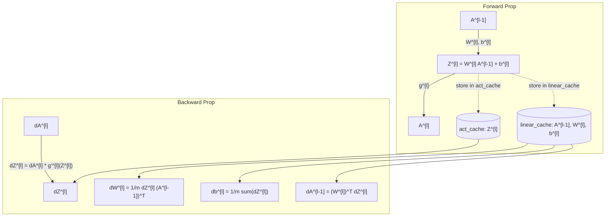

# Week 4: Deep L-Layer Neural Networks

> **Course 1: Neural Networks and Deep Learning** — *DeepLearning.AI / Andrew Ng*

---

## 1. Deep L-Layer Architecture

A deep neural network consists of $L$ layers ($L-1$ hidden layers and $1$ output layer).

### Architectural Notation:
- $L$: Total number of layers.
- $n^{[l]}$: Number of units in layer $l$.
- $n^{[0]} = n_x$: Number of input features.
- $a^{[l]} = g^{[l]}(z^{[l]})$: Activations of layer $l$.
- $a^{[L]} = \hat{y}$: Final predictions.

---

## 2. Forward and Backward Propagation Cache Pattern

To implement backpropagation cleanly in modular code, we store intermediate forward values in a **cache**:

---

## 3. Getting Matrix Dimensions Right

Debugging deep neural networks starts by checking matrix dimensions:

$$\begin{aligned}
W^{[l]} &\in \mathbb{R}^{n^{[l]} \times n^{[l-1]}} \\
b^{[l]} &\in \mathbb{R}^{n^{[l]} \times 1} \\
Z^{[l]}, A^{[l]} &\in \mathbb{R}^{n^{[l]} \times m} \\
dW^{[l]} &\in \mathbb{R}^{n^{[l]} \times n^{[l-1]}} \\
db^{[l]} &\in \mathbb{R}^{n^{[l]} \times 1} \\
dZ^{[l]}, dA^{[l]} &\in \mathbb{R}^{n^{[l]} \times m}
\end{aligned}$$

---

## 4. Parameters vs Hyperparameters

| Category | Variables | Description |
| :--- | :--- | :--- |
| **Model Parameters** | $W^{[1]}, b^{[1]}, \dots, W^{[L]}, b^{[L]}$ | Learned automatically from training data via gradient descent. |
| **Hyperparameters** | $\alpha$ (learning rate), number of iterations, number of layers $L$, hidden layer sizes $n^{[l]}$, activation choices ($g^{[l]}$), momentum, mini-batch size | Configured manually to control the learning algorithm. |
