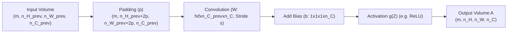

# Week 1: Foundations of Convolutional Neural Networks

> **Course 4: Convolutional Neural Networks** — *DeepLearning.AI / Andrew Ng*  
> **Learner & Implementer:** Eng. Ahmed Rifai

---

## 1. Motivation: Edge Detection & The Need for Convolutions

Traditional deep neural networks do not scale well to high-resolution images:
- A $1000 \times 1000 \times 3$ RGB image produces an input vector of dimension $x \in \mathbb{R}^{3,000,000}$.
- If the first hidden layer has $1,000$ hidden units, $W^{[1]}$ would contain $3 \times 10^{9}$ parameters (3 billion weights).
- This causes catastrophic overfitting, massive computational cost, and fails to exploit translation invariance and spatial locality.

Convolutional neural networks exploit two fundamental visual priors:
1. **Parameter sharing:** A feature detector (such as a vertical edge filter) useful in one part of an image is likely useful in another part.
2. **Sparsity of connections:** In each layer, each output neuron depends only on a tiny receptive field in the input.

---

## 2. Convolution Mathematics & Dimension Formulation

### 2.1 2D Convolution Operation
Given an input matrix $I \in \mathbb{R}^{n_H \times n_W}$ and a filter (kernel) $K \in \mathbb{R}^{f \times f}$:

$$S(i, j) = (I * K)(i, j) = \sum_{u=0}^{f-1} \sum_{v=0}^{f-1} I(i + u, j + v) K(u, v)$$

*(In deep learning, this operation is technically cross-correlation without kernel flipping, but conventionally referred to as convolution).*

### 2.2 Convolution over 3D Volumes (RGB & Multi-Channel)
When the input has multiple channels $n_C$ (e.g., RGB with $n_C = 3$), the filter must have the same channel depth $f \times f \times n_C$.

With $n_{C}'$ different filters, each filter detects a distinct feature pattern, producing an output volume with depth $n_{C}'$:

$$Z(i, j, c) = \sum_{u=0}^{f-1} \sum_{v=0}^{f-1} \sum_{k=0}^{n_C - 1} A_{\text{prev}}(i \cdot s + u, j \cdot s + v, k) \cdot W(u, v, k, c) + b_c$$

---

## 3. Padding and Strides

### 3.1 Padding ($p$)
Without padding, two major issues arise:
1. **Shrinking outputs:** Repeated convolutions cause spatial dimensions to shrink rapidly ($n \to n - f + 1$).
2. **Boundary pixel loss:** Pixels on the corners and edges are touched by very few filter windows compared to interior pixels.

- **Valid Convolution:** No padding ($p = 0$). Output dimensions:
  $$n_{\text{out}} = \lfloor \frac{n + 2p - f}{s} \rfloor + 1 = \lfloor \frac{n - f}{s} \rfloor + 1$$

- **Same Convolution:** Pad so output dimensions match input dimensions ($n_{\text{out}} = n$ when $s = 1$):
  $$p = \frac{f - 1}{2}$$
  *(Filters $f$ are typically odd numbers: $3 \times 3, 5 \times 5, 7 \times 7$ so that padding is symmetric).*

### 3.2 Output Dimension Formula
For an input volume of shape $(n_H^{[l-1]}, n_W^{[l-1]}, n_C^{[l-1]})$ convolved with $n_C^{[l]}$ filters of shape $(f, f, n_C^{[l-1]})$, with stride $s$ and padding $p$:

$$n_H^{[l]} = \left\lfloor \frac{n_H^{[l-1]} + 2p - f}{s} \right\rfloor + 1$$

$$n_W^{[l]} = \left\lfloor \frac{n_W^{[l-1]} + 2p - f}{s} \right\rfloor + 1$$

$$n_C^{[l]} = \text{number of filters}$$

---

## 4. Pooling Layers

Pooling layers reduce the spatial size of representations to reduce parameter count, prevent overfitting, and provide translation invariance.

- **Max Pooling:** Extracts the most salient detected feature in each window:
  $$A(i, j, c) = \max_{u, v \in [0, f-1]} A_{\text{prev}}(i \cdot s + u, j \cdot s + v, c)$$
- **Average Pooling:** Smooths out features across the window (often used at the end of modern architectures like ResNet/Inception):
  $$A(i, j, c) = \frac{1}{f^2} \sum_{u=0}^{f-1} \sum_{v=0}^{f-1} A_{\text{prev}}(i \cdot s + u, j \cdot s + v, c)$$

**Key Properties of Pooling:**
- **Zero Learnable Parameters:** Pooling layers have only fixed hyperparameters ($f$ and $s$), with no weights or biases.
- **Channel Preserving:** Pooling operates independently on each channel slice; $n_C^{[l]} = n_C^{[l-1]}$.

---

## 5. Receptive Field Analysis

The **receptive field** is the region of the input image that directly affects the activation of a particular neuron in layer $l$.

For a stack of convolutional layers with filter sizes $f_l$ and strides $s_l$:
- Layer 1 ($f_1$): Receptive field size $RF_1 = f_1$.
- Layer $l$:
  $$RF_l = RF_{l-1} + (f_l - 1) \cdot \prod_{i=1}^{l-1} s_i$$

### Effective Stride:
$$S_l = \prod_{i=1}^{l} s_i$$

Stacking two $3 \times 3$ convolutions ($s=1$) yields an effective receptive field of $5 \times 5$, but requires only $2 \times (3^2) = 18$ parameters per channel pair instead of $5^2 = 25$ parameters, while introducing an additional non-linearity.

---

## 6. Backpropagation in Convolutional & Pooling Layers

### 6.1 Convolution Backward Pass
Given incoming gradient $\frac{\partial \mathcal{L}}{\partial Z} = dZ \in \mathbb{R}^{m \times n_H \times n_W \times n_C}$:

$$\frac{\partial \mathcal{L}}{\partial W_c} = dW_c = \sum_{i=1}^{m} \sum_{h=0}^{n_H-1} \sum_{w=0}^{n_W-1} A_{\text{prev\_pad}}^{(i)}[h \cdot s : h \cdot s + f, w \cdot s : w \cdot s + f] \cdot dZ^{(i)}(h, w, c)$$

$$\frac{\partial \mathcal{L}}{\partial b_c} = db_c = \sum_{i=1}^{m} \sum_{h=0}^{n_H-1} \sum_{w=0}^{n_W-1} dZ^{(i)}(h, w, c)$$

$$dA_{\text{prev\_pad}}^{(i)}[h \cdot s : h \cdot s + f, w \cdot s : w \cdot s + f] += \sum_{c=0}^{n_C-1} W_c \cdot dZ^{(i)}(h, w, c)$$

After accumulation, unpad $dA_{\text{prev\_pad}}$ to obtain $dA_{\text{prev}}$.

### 6.2 Pooling Backward Pass
- **Max Pooling:** The gradient flows exclusively to the input neuron that was the maximum during forward prop:
  $$dA_{\text{prev}}[u, v] = \mathbf{1}_{\{A_{\text{prev}}[u, v] == \max\}} \cdot dA$$
- **Average Pooling:** The gradient is distributed equally among all elements in the pooling window:
  $$dA_{\text{prev}}[u, v] = \frac{1}{f^2} \cdot dA$$

---

## 7. Laboratory Implementations

- [`cnn_step_by_step.py`](file:///D:/STUDY/AI/Coursera/repos/Deep-Learning-Specialization/04-Convolutional-Neural-Networks/Week-1-Foundations-of-CNNs/Convolution-Model-Step-by-Step/cnn_step_by_step.py): Pure vectorized NumPy implementation of 2D/3D CONV, POOL, and their backward passes, verified with 100% numerical precision against Coursera test suites.
- `Convolution-Model-Application`: Application of ConvNet using modern high-level frameworks (TensorFlow/Keras) for binary and multi-class image classification.
