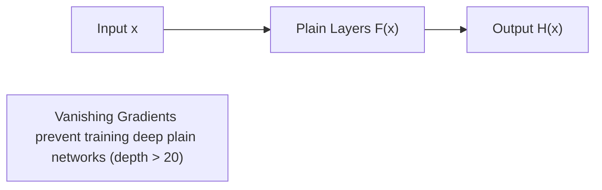
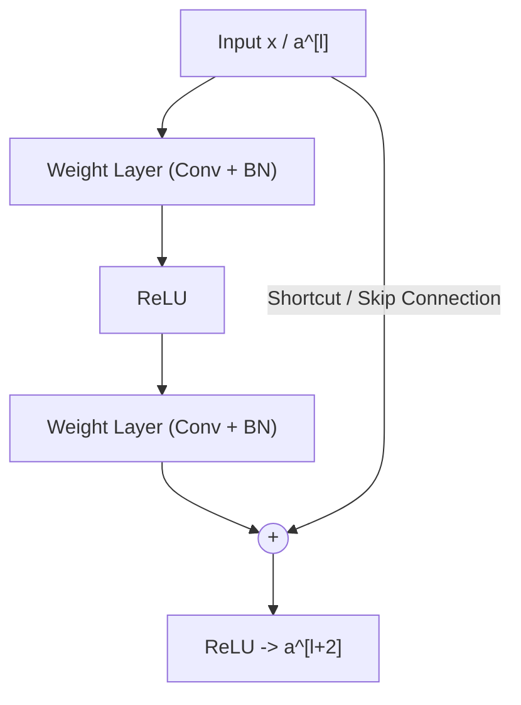
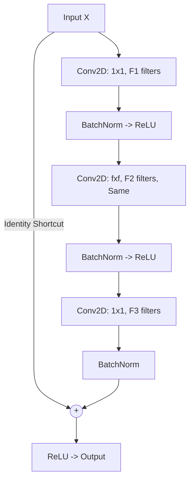
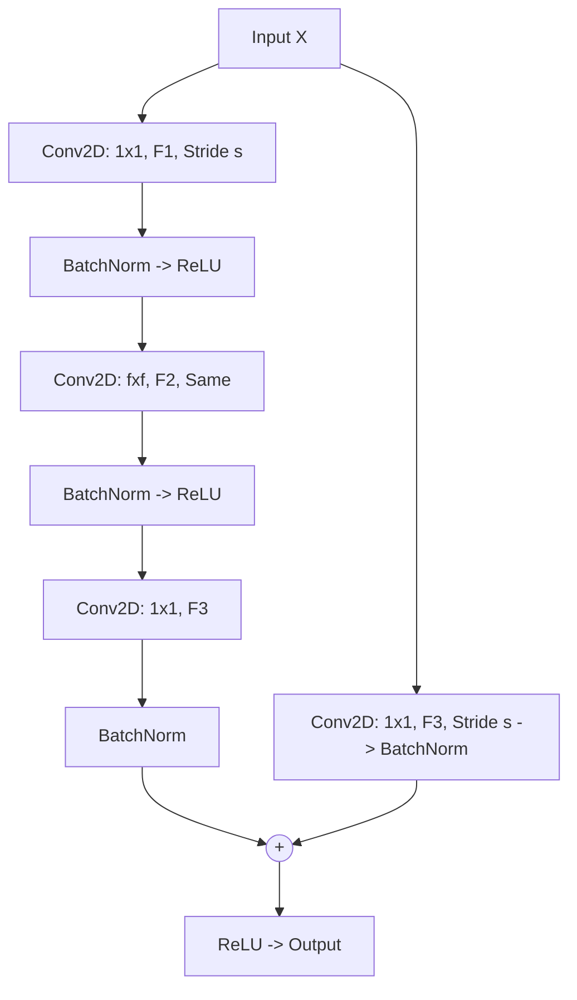

# Week 2: Deep Convolutional Models & Residual Networks (ResNets)

> **Course 4: Convolutional Neural Networks** — *DeepLearning.AI / Andrew Ng*  
> **Learner & Implementer:** Eng. Ahmed Rifai

---

## 1. The Degradation Problem in Very Deep Networks

In theory, deeper neural networks have greater representational capacity and should achieve lower training error. However, in practice, as network depth exceeds ~20 layers, **plain networks** experience the **degradation problem**:
- Training error gets *worse* as depth increases, not due to overfitting, but due to optimization failure (vanishing/exploding gradients).
- Backpropagation gradients diminish exponentially through many multiplication layers, making early layers learn extremely slowly.

---

## 2. Residual Learning & Skip Connections

Kaiming He et al. (2015) introduced the **Residual Network (ResNet)**, which reformulates layers as learning residual functions with reference to layer inputs.

Instead of hoping a stack of layers directly fits an underlying mapping $\mathcal{H}(x)$, we let these layers fit a **residual mapping**:

$$\mathcal{F}(x) := \mathcal{H}(x) - x$$

The original mapping becomes:

$$\mathcal{H}(x) = \mathcal{F}(x) + x$$

### 2.1 Mathematical Formulation:
For a 2-layer residual block:

$$z^{[l+1]} = W^{[l+1]} a^{[l]} + b^{[l+1]}$$

$$a^{[l+1]} = g(z^{[l+1]})$$

$$z^{[l+2]} = W^{[l+2]} a^{[l+1]} + b^{[l+2]}$$

$$a^{[l+2]} = g(z^{[l+2]} + a^{[l]})$$

### 2.2 Why ResNets Work So Well:
If weight decay or regularization drives $W^{[l+2]} \to 0$ and $b^{[l+2]} \to 0$:

$$a^{[l+2]} = g(0 + a^{[l]}) = g(a^{[l]}) = a^{[l]} \quad (\text{for ReLU with } a^{[l]} \ge 0)$$

The identity mapping is trivial for a residual block to learn. Thus, adding residual blocks to a deep architecture **guarantees that performance will not degrade**, allowing training of networks with 50, 101, or even 152+ layers.

---

## 3. Residual Block Variants

In deeper ResNets (such as ResNet-50), a **bottleneck design** with 3 convolutional layers ($1 \times 1 \to 3 \times 3 \to 1 \times 1$) is used to reduce computational complexity.

### 3.1 The Identity Block
Used when the input activation and output activation have identical dimensions ($n_H, n_W, n_C$):

### 3.2 The Convolutional Block
Used when the input and output dimensions do not match (e.g., spatial dimensions halved with stride $s=2$, or channel depth expands):
- A $1 \times 1$ convolution with stride $s$ and $F_3$ filters is applied along the **shortcut path**:
  $$\text{Shortcut}(X) = \text{BatchNorm}(\text{Conv}_{1 \times 1}(X))$$

---

## 4. ResNet-50 Complete Architecture

ResNet-50 consists of 5 stages totaling 50 layers with weights:

| Stage | Layer / Block | Output Size | Specifications |
|---|---|---|---|
| **Input** | Raw Image | $64 \times 64 \times 3$ | Input Tensor |
| **Stage 1** | ZeroPadding + Conv1 + MaxPool | $16 \times 16 \times 64$ | $7 \times 7$ Conv (stride 2), $3 \times 3$ MaxPool (stride 2) |
| **Stage 2** | 1 ConvBlock + 2 IdentityBlocks | $16 \times 16 \times 256$ | Filters: $[64, 64, 256]$, $s=1$ |
| **Stage 3** | 1 ConvBlock + 3 IdentityBlocks | $8 \times 8 \times 512$ | Filters: $[128, 128, 512]$, $s=2$ |
| **Stage 4** | 1 ConvBlock + 5 IdentityBlocks | $4 \times 4 \times 1024$ | Filters: $[256, 256, 1024]$, $s=2$ |
| **Stage 5** | 1 ConvBlock + 2 IdentityBlocks | $2 \times 2 \times 2048$ | Filters: $[512, 512, 2048]$, $s=2$ |
| **Output** | AvgPool + Flatten + Dense | $K$ (e.g. 6 classes) | $2 \times 2$ Average Pooling, Dense Softmax |

---

## 5. $1 \times 1$ Convolutions (Network in Network)

A $1 \times 1$ convolution acts as a slice-wise fully connected layer across channels at each spatial position:
- **Channel Pooling / Compression:** Reduces depth from $n_C \to n_C'$ while keeping spatial resolution ($n_H, n_W$) intact.
- **Adds Non-Linearity:** Adds an activation layer (e.g. ReLU) without increasing spatial filter receptive field.
- **Bottleneck Layer:** Cuts computational multiplications significantly before computationally expensive $3 \times 3$ or $5 \times 5$ convolutions.

---

## 6. Transfer Learning Workflow

1. Download pretrained weights (e.g. trained on ImageNet with 1.4 million images).
2. Freeze base convolutional layers (`layer.trainable = False`).
3. Replace the classification head (Dense layers) with custom task-specific layers.
4. Train new classification head on the target dataset.
5. (Optional) Fine-tuning: Unfreeze top convolutional stages and train with a very small learning rate ($\alpha \approx 10^{-5}$).
