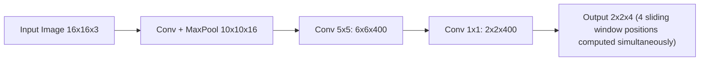
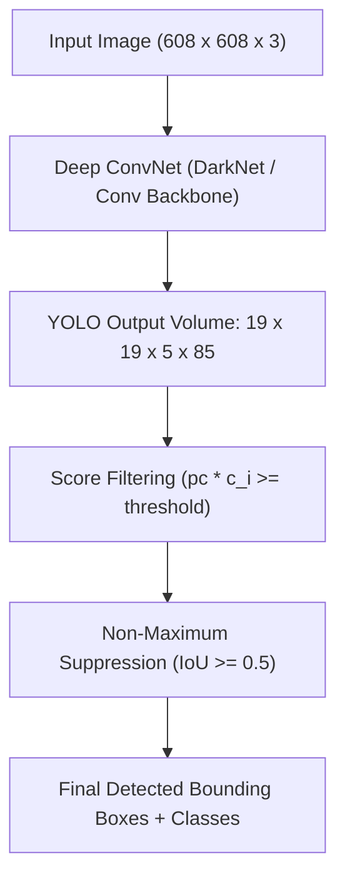

# Week 3: Object Detection & The YOLO Algorithm

> **Course 4: Convolutional Neural Networks** — *DeepLearning.AI / Andrew Ng*  
> **Learner & Implementer:** Eng. Ahmed Rifai

---

## 1. Problem Formulations

Computer Vision recognition tasks follow a progression of complexity:

1. **Image Classification:** What object is in the image? (Single label output $y$).
2. **Classification with Localization:** What object is in the image, and where is it located? (Label $c$ + Bounding box $(b_x, b_y, b_h, b_w)$).
3. **Object Detection:** Detect multiple objects of diverse classes across arbitrary positions and scales.

### Target Vector for Single-Object Localization:
$$y = \begin{bmatrix} p_c \\ b_x \\ b_y \\ b_h \\ b_w \\ c_1 \\ c_2 \\ c_3 \end{bmatrix}$$

- $p_c$: Probability that an object is present ($1$ if present, $0$ if background).
- $(b_x, b_y)$: Center coordinates of the bounding box (normalized $0 \dots 1$).
- $(b_h, b_w)$: Height and width of the bounding box.
- $c_1, c_2, c_3$: One-hot class probabilities.

If $p_c = 0$, the loss function ignores bounding box coordinates and class predictions:

$$\mathcal{L}(\hat{y}, y) = \begin{cases} \sum_{i=1}^8 (\hat{y}_i - y_i)^2 & \text{if } y_1 = 1 \\ (\hat{y}_1 - y_1)^2 & \text{if } y_1 = 0 \end{cases}$$

---

## 2. Convolutional Sliding Windows

Traditional sliding windows crop thousands of rectangular patches and run each patch through a forward pass of a CNN, which is computationally prohibitive.

Sermanet et al. (OverFeat) introduced **fully convolutional sliding windows**:
- Fully Connected (FC) layers can be converted into $1 \times 1$ convolutional layers.
- For example, an FC layer with $400$ units on a $5 \times 5 \times 16$ input is equivalent to a Conv layer with $400$ filters of shape $5 \times 5 \times 16$.
- Convolving this network over a larger image (e.g. $16 \times 16 \times 3$ instead of $14 \times 14 \times 3$) automatically computes predictions across all sliding window positions in a **single forward pass** with complete feature sharing.

---

## 3. YOLO (You Only Look Once) Algorithm

YOLO (Redmon et al.) formulates object detection as a single regression problem from image pixels directly to bounding box coordinates and class probabilities.

### 3.1 Grid Cell Assignment
1. The input image ($608 \times 608$) is divided into an $S \times S$ grid (e.g., $19 \times 19$).
2. Each ground-truth object is assigned to **exactly one grid cell**: the cell that contains the **midpoint / center $(b_x, b_y)$** of the object.
3. Each grid cell outputs predictions for $B$ anchor boxes:
   $$\text{Output Tensor Shape: } S \times S \times (B \times (5 + C))$$
   For $S = 19$, $B = 5$, and $C = 80$ (COCO dataset classes):
   $$\text{Tensor Shape: } 19 \times 19 \times 5 \times 85 = 19 \times 19 \times 425$$

### 3.2 Bounding Box Encoding:
- $b_x, b_y \in [0, 1]$: Relative to the top-left corner of the grid cell.
- $b_h, b_w \in \mathbb{R}^+$: Relative to the overall width and height of the grid cell or image.

---

## 4. Intersection over Union (IoU)

Intersection over Union measures the degree of overlap between the predicted bounding box $B_{\text{pred}}$ and ground-truth box $B_{\text{gt}}$:

$$\text{IoU} = \frac{\text{Area}(B_{\text{pred}} \cap B_{\text{gt}})}{\text{Area}(B_{\text{pred}} \cup B_{\text{gt}})}$$

- Conventionally, a detection is considered correct if $\text{IoU} \ge 0.5$.
- Higher thresholds ($\text{IoU} \ge 0.75$) demand tighter localization precision.

---

## 5. Non-Maximum Suppression (NMS)

Because neighboring grid cells may all predict the same object, YOLO generates multiple overlapping boxes. Non-Maximum Suppression eliminates redundant detections:

1. **Threshold Filtering:** Discard all candidate boxes where confidence score $p_c \cdot c_k < \tau_{\text{conf}}$ (e.g. $< 0.6$).
2. **Sort:** Order remaining boxes by confidence score in descending order.
3. **Iterative Suppression:**
   - Select the box $b^*$ with the highest score and add it to final detections.
   - For all remaining boxes $b$, compute $\text{IoU}(b^*, b)$.
   - Remove any box $b$ where $\text{IoU}(b^*, b) \ge \tau_{\text{IoU}}$ (e.g. $\ge 0.5$).
   - Repeat until no candidate boxes remain.

---

## 6. Anchor Boxes

When multiple objects have their centers in the same grid cell, or when objects have distinctly different aspect ratios (e.g. tall pedestrian vs wide car), **anchor boxes** are used:
- Each anchor box represents a predefined aspect ratio prior.
- Ground truth is assigned to the pair: $(\text{Grid Cell}, \text{Anchor Box})$ with the highest IoU with the object's ground-truth shape.

---

## 7. Laboratory: Autonomous Driving Car Detection

The laboratory implementation applies a pre-trained YOLOv2 model on dashboard camera frames:
- Filtering boxes by class thresholding.
- Computing intersection and union coordinates:
  $$x_1 = \max(box1_{x1}, box2_{x1}), \quad y_1 = \max(box1_{y1}, box2_{y1})$$
  $$x_2 = \min(box1_{x2}, box2_{x2}), \quad y_2 = \min(box1_{y2}, box2_{y2})$$
- Applying TensorFlow's vectorized `tf.image.non_max_suppression`.
