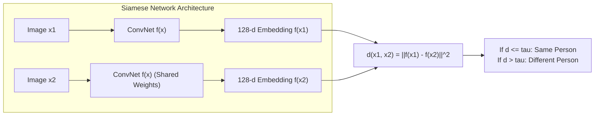
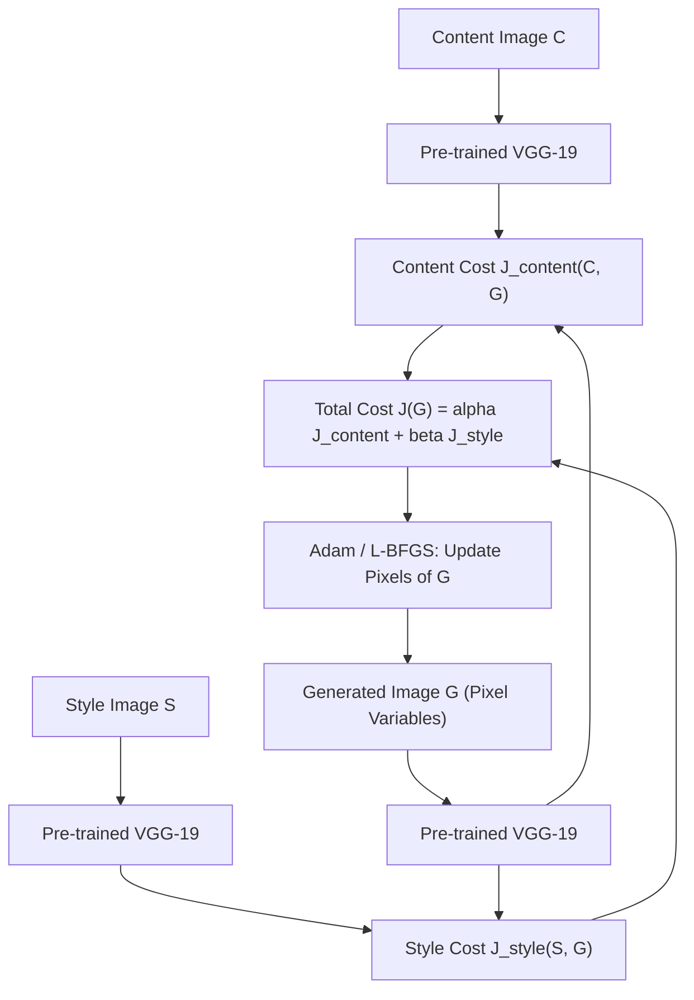

# Week 4: Special Applications — Face Recognition & Neural Style Transfer

> **Course 4: Convolutional Neural Networks** — *DeepLearning.AI / Andrew Ng*  
> **Learner & Implementer:** Eng. Ahmed Rifai

---

## 1. Face Verification vs Face Recognition

- **Face Verification (1:1 matching):**
  - Input: Image + Claimed Identity (e.g. employee ID badge).
  - Output: Binary decision (True/False) determining if the image matches the claimed identity.
  - Accuracy requirement: $>99\%$, false acceptance rate near $0\%$.

- **Face Recognition (1:K matching):**
  - Input: Image.
  - Output: Identity of the person from a database of $K$ people (or "Not recognized").
  - Significantly harder: An error rate of $1\%$ on verification accumulates to $1 - (0.99)^K \approx 63\%$ failure rate for $K=100$.

---

## 2. One-Shot Learning & Siamese Networks

Traditional classification models cannot handle one-shot learning because they require hundreds of training examples per person, and retraining the softmax layer whenever a new employee joins is impractical.

Instead, we train a network to learn a **similarity function**:

$$d(\text{img}_1, \text{img}_2) = \text{degree of difference between images}$$

---

## 3. Triplet Loss Function (FaceNet)

Schroff et al. (FaceNet, 2015) introduced the **Triplet Loss**, which compares an **Anchor ($A$)** against a **Positive ($P$)** (same person) and a **Negative ($N$)** (different person):

### 3.1 Objective:
We want the anchor to be much closer to the positive than to the negative by at least a margin $\alpha > 0$:

$$\|f(A) - f(P)\|^2 + \alpha \le \|f(A) - f(N)\|^2$$

$$\|f(A) - f(P)\|^2 - \|f(A) - f(N)\|^2 + \alpha \le 0$$

### 3.2 Loss Formulation:
To prevent trivial solutions (like $f(x) = 0$ everywhere), the loss is defined as:

$$\mathcal{L}(A, P, N) = \max\left(\|f(A) - f(P)\|^2 - \|f(A) - f(N)\|^2 + \alpha, 0\right)$$

Total cost over $m$ triplets:

$$J = \sum_{i=1}^{m} \mathcal{L}(A^{(i)}, P^{(i)}, N^{(i)})$$

### 3.3 Triplet Selection:
If triplets are chosen randomly, the constraint $d(A, P) + \alpha \le d(A, N)$ is satisfied easily and gradients are mostly zero. For efficient training:
- Select **hard triplets** where $d(A, P) \approx d(A, N)$, forcing the network to optimize feature representations.

---

## 4. Neural Style Transfer (NST)

Gatys et al. (2015) formulated Neural Style Transfer by decomposing deep visual features into **Content** and **Style** using a pre-trained VGG-19 network.

Given:
- **Content image ($C$)**
- **Style image ($S$)**
- **Generated image ($G$)** (initialized with white noise or image $C$)

### 4.1 Total Cost Function:
$$J(G) = \alpha J_{\text{content}}(C, G) + \beta J_{\text{style}}(S, G)$$

### 4.2 Content Cost Function:
Using hidden layer $l$ of VGG-19 (e.g. `block4_conv2`):

$$J_{\text{content}}(C, G) = \frac{1}{4 \times n_H^{[l]} \times n_W^{[l]} \times n_C^{[l]}} \sum_{i, j, k} \left(a^{[l](C)}_{i, j, k} - a^{[l](G)}_{i, j, k}\right)^2$$

### 4.3 Style Cost Function & The Gram Matrix:
Style is captured by the correlation between different feature channels across spatial positions.

The **Gram Matrix (unnormalized cross-correlation)** of activation matrix $A \in \mathbb{R}^{(n_H \times n_W) \times n_C}$ is:

$$G_{k, k'}^{[l]} = \sum_{i=1}^{n_H} \sum_{j=1}^{n_W} a_{i, j, k}^{[l]} \cdot a_{i, j, k'}^{[l]}$$

Or in matrix form: $G^{[l]} = (A^{[l]})^T A^{[l]}$.

The style cost for layer $l$ is:

$$J^{[l]}_{\text{style}}(S, G) = \frac{1}{4 \cdot (n_H^{[l]} \times n_W^{[l]})^2 \cdot (n_C^{[l]})^2} \sum_{k=1}^{n_C} \sum_{k'=1}^{n_C} \left(G_{k, k'}^{[l](S)} - G_{k, k'}^{[l](G)}\right)^2$$

Total style cost combines multiple layers with weighting factors $\lambda^{[l]}$:

$$J_{\text{style}}(S, G) = \sum_{l} \lambda^{[l]} J^{[l]}_{\text{style}}(S, G)$$

---

## 5. Course 4 Milestone Summary

Across all 4 weeks:
1. **Week 1:** Mastered convolution and pooling fundamentals, dimensions, receptive fields, and raw NumPy backprop vectorization.
2. **Week 2:** Mastered deep architectures, degradation breakdown, and ResNet-50 skip connections.
3. **Week 3:** Mastered real-time object detection with fully convolutional sliding windows, YOLO grid mapping, IoU, and NMS.
4. **Week 4:** Mastered advanced special applications with Siamese networks, FaceNet triplet loss, and VGG-19 Neural Style Transfer.
