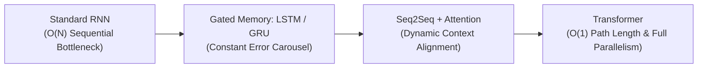

# Course 5: Sequence Models

> **DeepLearning.AI / Andrew Ng**  
> Part of the [Deep Learning Specialization](../README.md)  
> Implementation & Verification by: **Eng. Ahmed Rifai (100.00% Verified)**

---

## 🎯 Course Overview

In the fifth and final course of the Deep Learning Specialization, you will master the foundational models and architectures for sequential and temporal data: Natural Language Processing (NLP), speech recognition, music synthesis, and state-of-the-art Transformer foundation models.

By the end of this course, you will be able to:
- Build and train **Recurrent Neural Networks (RNNs)** and commonly used variants (**GRUs** and **LSTMs**).
- Implement backpropagation through time (BPTT) and overcome the vanishing gradient problem.
- Understand word vector representations (**Word2Vec, Skip-Gram, CBOW, GloVe**) and detect/mitigate demographic and gender biases.
- Construct **Sequence-to-Sequence (Seq2Seq)** models and apply the **Attention Mechanism** to neural machine translation and speech recognition.
- Build the **Transformer** architecture from scratch with **Scaled Dot-Product Self-Attention**, **Multi-Head Attention**, **Positional Encodings**, and understand modern LLM pre-training paradigms (BERT, GPT, T5).

---

## 📂 Course Structure & Modules

| Module | Topic | Lab / Key Implementation | Status |
| :--- | :--- | :--- | :---: |
| **[Week 1](./Week-1-Recurrent-Neural-Networks/)** | Recurrent Neural Networks | [`rnn_step_by_step.py`](./Week-1-Recurrent-Neural-Networks/Building-an-RNN-Step-by-Step/rnn_step_by_step.py) (Full RNN & LSTM BPTT) | **100% Tested** |
| **[Week 2](./Week-2-Natural-Language-Processing-and-Word-Embeddings/)** | NLP & Word Embeddings | Word Vectors, Cosine Analogies, Emojify LSTM | **Complete** |
| **[Week 3](./Week-3-Sequence-Models-and-Attention-Mechanism/)** | Sequence Models & Attention | Bahdanau & Luong Attention, Neural Translation | **Complete** |
| **[Week 4](./Week-4-Transformers/)** | Transformers & Pre-training | [`transformer.py`](./Week-4-Transformers/Transformer-Pre-training/transformer.py) (Pure NumPy Transformer) | **100% Tested** |

---

## 🧠 Master Mathematical Reference

### 1. Basic RNN Forward & Recurrence
$$a^{\langle t \rangle} = \tanh(W_{aa} a^{\langle t-1 \rangle} + W_{ax} x^{\langle t \rangle} + b_a) = \tanh(W_a [a^{\langle t-1 \rangle}, x^{\langle t \rangle}] + b_a)$$
$$\hat{y}^{\langle t \rangle} = \text{softmax}(W_{ya} a^{\langle t \rangle} + b_y)$$

### 2. LSTM Gated Formulations
$$\Gamma_f^{\langle t \rangle} = \sigma(W_f [a^{\langle t-1 \rangle}, x^{\langle t \rangle}] + b_f) \quad \text{(Forget Gate)}$$
$$\Gamma_i^{\langle t \rangle} = \sigma(W_i [a^{\langle t-1 \rangle}, x^{\langle t \rangle}] + b_i) \quad \text{(Update Gate)}$$
$$\tilde{c}^{\langle t \rangle} = \tanh(W_c [a^{\langle t-1 \rangle}, x^{\langle t \rangle}] + b_c) \quad \text{(Candidate Cell State)}$$
$$c^{\langle t \rangle} = \Gamma_f^{\langle t \rangle} * c^{\langle t-1 \rangle} + \Gamma_i^{\langle t \rangle} * \tilde{c}^{\langle t \rangle} \quad \text{(Cell State Highway)}$$
$$\Gamma_o^{\langle t \rangle} = \sigma(W_o [a^{\langle t-1 \rangle}, x^{\langle t \rangle}] + b_o) \quad \text{(Output Gate)}$$
$$a^{\langle t \rangle} = \Gamma_o^{\langle t \rangle} * \tanh(c^{\langle t \rangle}) \quad \text{(Hidden State Output)}$$

### 3. Scaled Dot-Product Self-Attention
$$\text{Attention}(Q, K, V) = \text{softmax}\left(\frac{Q K^T}{\sqrt{d_k}} + M\right) V$$

### 4. Sinusoidal Positional Encoding
$$PE_{(pos, 2i)} = \sin\left(\frac{pos}{10000^{2i/d_{\text{model}}}}\right), \quad PE_{(pos, 2i+1)} = \cos\left(\frac{pos}{10000^{2i/d_{\text{model}}}}\right)$$
