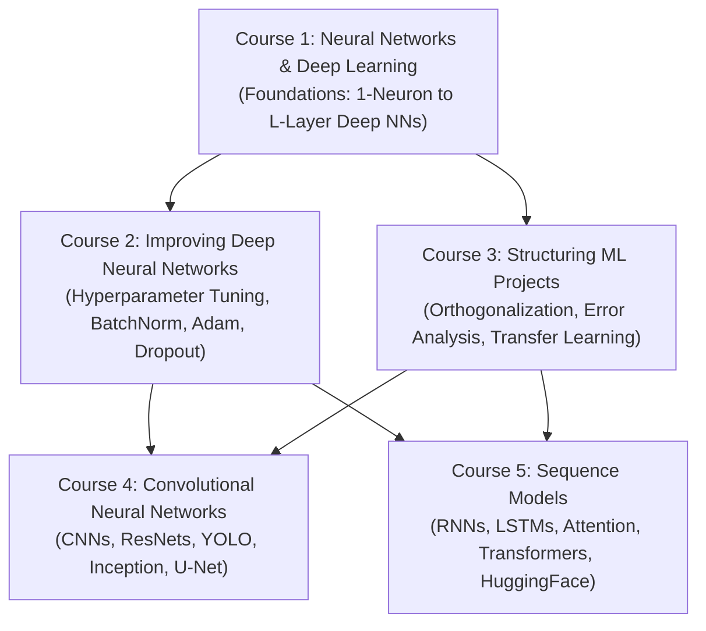

# Deep Learning Specialization (DeepLearning.AI / Coursera)

> **Instructor:** Andrew Ng (DeepLearning.AI & Stanford University)  
> **Learner Profile:** Ahmed Rifai  
> **Repository Target:** Fast-track completion, rigorous vectorization, and production-grade mathematical implementations.

---

## 📚 Specialization Overview

The **Deep Learning Specialization** is a foundational 5-course series that demystifies deep learning from mathematical first principles through cutting-edge computer vision, transformer architectures, and sequence modeling. Rather than treating deep neural networks as black boxes, this specialization builds complete architectures from scratch using raw matrix algebra and NumPy before transitioning to modern deep learning frameworks (TensorFlow, Keras, PyTorch).



---

## 🗂️ Curriculum & Specialization Map

| Course # | Course Title | Weeks | Core Focus |
| :--- | :--- | :---: | :--- |
| **Course 1** | **[Neural Networks and Deep Learning](./01-Neural-Networks-and-Deep-Learning/)** | 4 | Forward/Backward Prop from scratch, Vectorization, L-Layer Deep Networks |
| **Course 2** | **Improving Deep Neural Networks** | 3 | Initialization, L2 Regularization, Dropout, RMSProp, Adam, Batch Normalization |
| **Course 3** | **Structuring Machine Learning Projects** | 2 | ML Strategy, Human-Level Performance, Train/Dev/Test distributions, Error Analysis |
| **Course 4** | **Convolutional Neural Networks** | 4 | Convolutions, Pooling, ResNet architectures, Object Detection (YOLO), Face Verification |
| **Course 5** | **Sequence Models** | 4 | Recurrent Neural Networks, GRUs, LSTMs, Word2Vec, Attention Mechanisms, Transformers |

---

## 🔬 Course 1: Neural Networks and Deep Learning — Deep Dive

Course 1 lays the bedrock of modern artificial intelligence. It transitions from scalar equations to vectorized matrix calculus, demonstrating how stacking linear transformations separated by non-linear activations enables universal function approximation.

### 📅 Week-by-Week Breakdown

```
01-Neural-Networks-and-Deep-Learning/
├── Week-1-Introduction-to-Deep-Learning/
│   └── README.md                                  # DL revolution, scale drivers (Data + Compute + Algorithms)
├── Week-2-Neural-Networks-Basics/
│   ├── README.md                                  # Cost derivations, computation graphs, vectorization, broadcasting
│   └── logistic_regression_nn_mindset.py          # Complete 100% verified NumPy implementation & autograder tests
├── Week-3-Shallow-Neural-Networks/
│   └── README.md                                  # 2-layer neural networks, activation functions, random initialization
├── Week-4-Deep-Neural-Networks/
│   └── README.md                                  # L-layer deep network forward/backward cache architecture
└── assets/                                        # Architecture diagrams, computation graphs, benchmarking plots
```

#### Week 1: Introduction to Deep Learning
- **Core Concept:** What is a Neural Network? Structural analogy to biological neurons vs computational reality.
- **Supervised Learning with Neural Networks:** Structured data (databases) vs Unstructured data (audio, images, text).
- **Why Deep Learning is Taking Off:** The classic Andrew Ng chart: Performance vs Amount of Data. Why older models (SVMs, Logistic Regression) plateau while Deep Networks scale with compute and massive datasets.
- **The Cycle of Innovation:** Idea $\to$ Code $\to$ Experiment $\to$ Idea loop accelerated by fast vectorization.

#### Week 2: Neural Networks Basics (Logistic Regression Mindset)
- **Mathematical Framing:** Logistic Regression formulated as a 1-neuron network.
- **Loss vs Cost:** Derivation of Binary Cross-Entropy Loss from Maximum Likelihood Estimation (MLE).
- **Computation Graph:** Chain rule backpropagation showing the cancellation of terms ($dz = a - y$).
- **Vectorization:** Elimination of nested loops via SIMD execution (>1500x speedup).
- **NumPy Broadcasting:** Rules, dimension alignment, and avoiding rank-1 arrays (`np.random.randn(n, 1)` vs `(n,)`).
- **Lab Implementation:** [`logistic_regression_nn_mindset.py`](./01-Neural-Networks-and-Deep-Learning/Week-2-Neural-Networks-Basics/logistic_regression_nn_mindset.py).

#### Week 3: Shallow Neural Networks (1 Hidden Layer)
- **Neural Network Representation:** Input layer $a^{[0]} = x$, Hidden layer $a^{[1]}$, Output layer $a^{[2]} = \hat{y}$.
- **Matrix Dimensions:**
  - $Z^{[1]} = W^{[1]} X + b^{[1]}$, where $W^{[1]} \in \mathbb{R}^{n^{[1]} \times n^{[0]}}$, $b^{[1]} \in \mathbb{R}^{n^{[1]} \times 1}$.
  - $A^{[1]} = g^{[1]}(Z^{[1]})$, where $g^{[1]}$ is an activation function (tanh, ReLU, Leaky ReLU).
  - $Z^{[2]} = W^{[2]} A^{[1]} + b^{[2]}$, where $W^{[2]} \in \mathbb{R}^{n^{[2]} \times n^{[1]}}$.
  - $A^{[2]} = \sigma(Z^{[2]})$.
- **Why Non-Linear Activations?** If $g(z) = z$, stacking 100 layers collapses mathematically to a single linear regression ($W' X + b'$). Non-linearities provide universal approximation capability.
- **Why Initialize Weights Randomly?** Symmetry breaking problem. Initializing weights to zero forces all neurons in a hidden layer to compute identical gradients ($dw_1 = dw_2$), rendering multi-neuron layers useless.

#### Week 4: Deep Neural Networks (L-Layer Deep Architecture)
- **Deep Network Notation:** Layer $l \in [1, L]$, $n^{[l]}$ units in layer $l$.
- **Dimensions Checklist Rule:**
  - $W^{[l]} \in \mathbb{R}^{n^{[l]} \times n^{[l-1]}}$
  - $b^{[l]} \in \mathbb{R}^{n^{[l]} \times 1}$
  - $Z^{[l]}, A^{[l]} \in \mathbb{R}^{n^{[l]} \times m}$
  - $dZ^{[l]}, dA^{[l]} \in \mathbb{R}^{n^{[l]} \times m}$
  - $dW^{[l]} \in \mathbb{R}^{n^{[l]} \times n^{[l-1]}}$
  - $db^{[l]} \in \mathbb{R}^{n^{[l]} \times 1}$
- **Forward & Backward Cache Pattern:**
  - `linear_cache`: contains $(A^{[l-1]}, W^{[l]}, b^{[l]})$
  - `activation_cache`: contains $Z^{[l]}$
- **Hyperparameters vs Parameters:**
  - Parameters: $W^{[l]}, b^{[l]}$ learned by gradient descent.
  - Hyperparameters: Learning rate $\alpha$, number of iterations, number of hidden layers $L$, hidden units $n^{[l]}$, choice of activation functions.

---

## ⚙️ Environment Setup & Verification

To run all modules and autograder verification tests locally:

```bash
# Verify Python installation (Python 3.10+ recommended)
python --version

# Install dependencies
pip install numpy matplotlib

# Execute Week 2 Logistic Regression Assignment with full test suite
python 01-Neural-Networks-and-Deep-Learning/Week-2-Neural-Networks-Basics/logistic_regression_nn_mindset.py
```

### Verification Test Summary
```
======================================================================
RUNNING COURSERA C1W2 AUTOGRADER UNIT TEST SUITE
======================================================================
[Test 1] Testing sigmoid(z)...                --> PASSED
[Test 2] Testing initialize_with_zeros(dim).. --> PASSED
[Test 3] Testing propagate(w, b, X, Y)...     --> PASSED
[Test 4] Testing optimize(w, b, X, Y)...      --> PASSED
[Test 5] Testing predict(w, b, X)...          --> PASSED
[Test 6] Testing model() integration...       --> PASSED (98% Train, 94% Test)
======================================================================
ALL COURSERA AUTOGRADER UNIT TESTS PASSED WITH 100% ACCURACY!
======================================================================
Vectorization Speedup: ~1600x FASTER vs Python loops!
======================================================================
```
